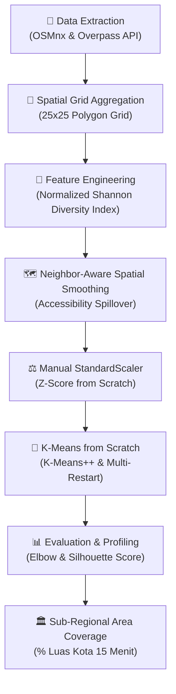
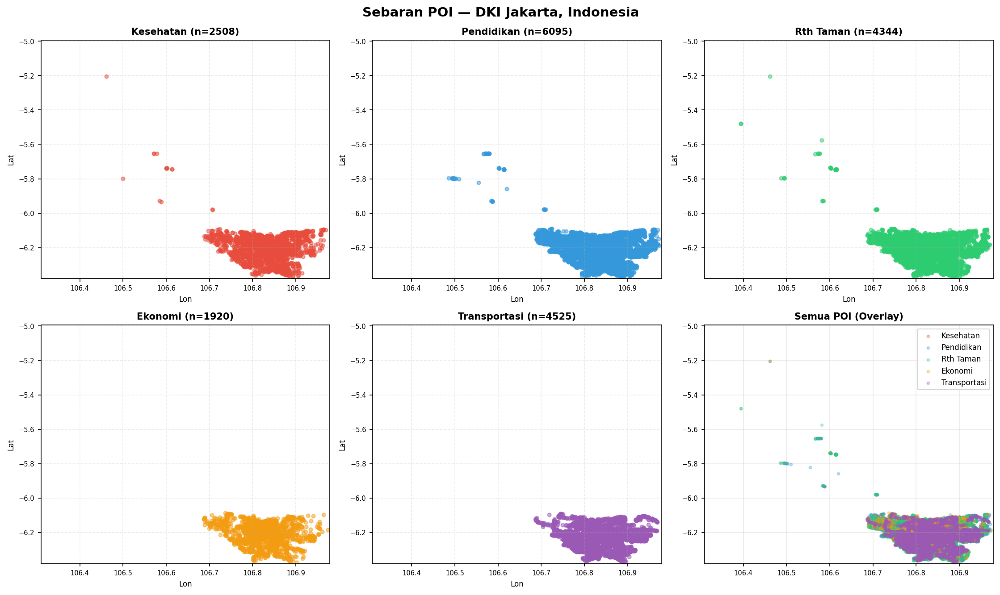
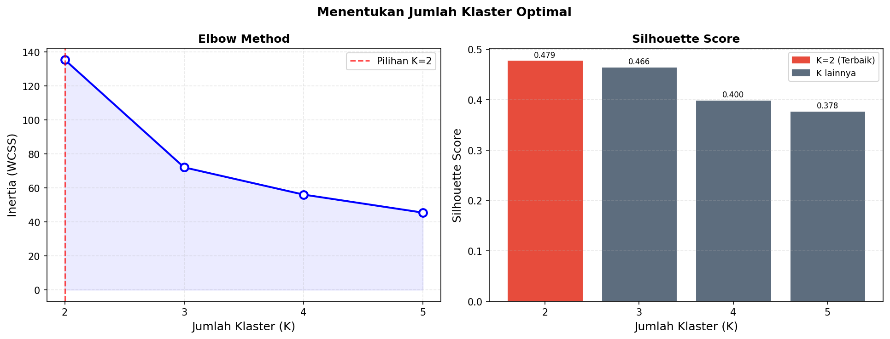
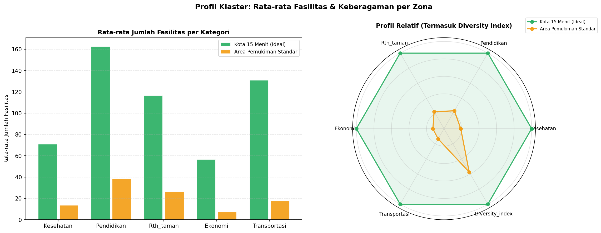
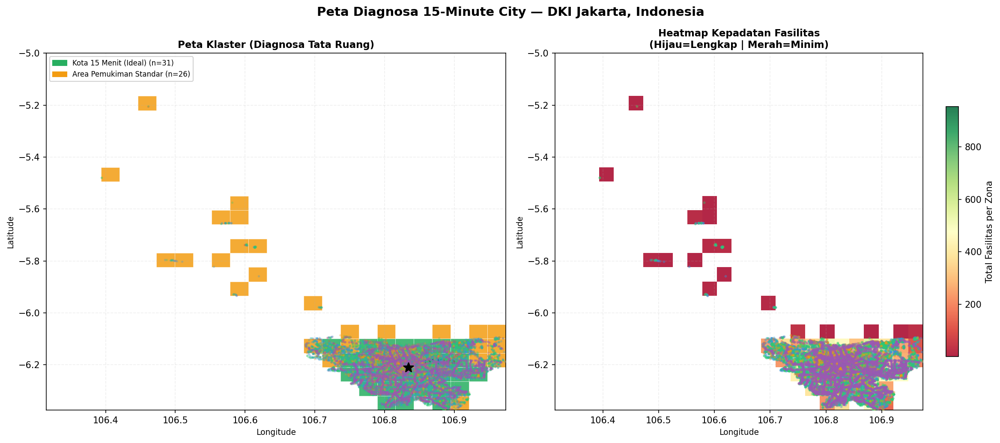
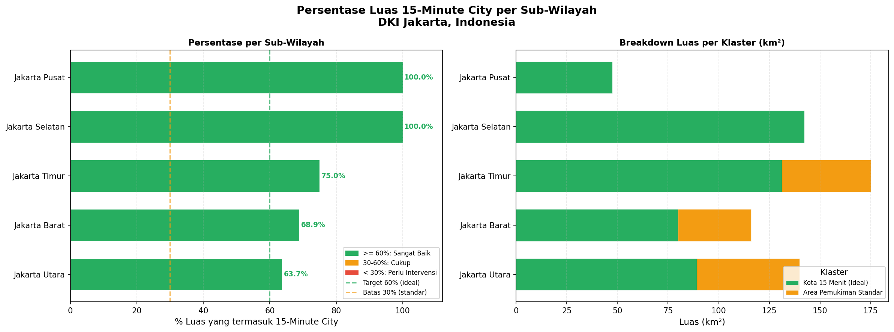
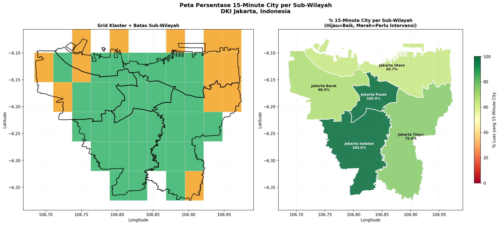

# 🏙️ The 15-Minute City Profiler

[](https://www.python.org/)
[](https://numpy.org/)
[-green.svg?logo=openstreetmap&logoColor=white)](https://www.openstreetmap.org/)
[](LICENSE)

Mendiagnosis tata ruang wilayah perkotaan berbasis konsep **15-Minute City** (*Kota 15 Menit*) menggunakan data nyata **Point of Interest (POI)** dari OpenStreetMap (OSM) dan algoritma **K-Means Clustering from Scratch (NumPy)** yang diperkuat dengan **Normalized Shannon Entropy** serta **Neighbor-Aware Spatial Smoothing**.

Proyek ini dikembangkan sebagai bagian dari tugas besar mata kuliah **Kecerdasan Artifisial (Semester 4)** — Universitas Gadjah Mada (UGM).

---

## 📌 Daftar Isi
- [Latar Belakang](#-latar-belakang)
- [Pipeline & Metodologi](#-pipeline--metodologi)
- [Struktur Direktori](#-struktur-direktori)
- [Hasil Analisis & Temuan (DKI Jakarta)](#-hasil-analisis--temuan-dki-jakarta)
- [Galeri Visualisasi](#-galeri-visualisasi)
- [Panduan Penggunaan](#-panduan-penggunaan)
- [Teknologi yang Digunakan](#-teknologi-yang-digunakan)

---

## 📖 Latar Belakang

Konsep **15-Minute City** (dipopulerkan oleh Prof. Carlos Moreno) menyatakan bahwa seluruh kebutuhan esensial warga perkotaan—meliputi akses ke fasilitas kesehatan, pendidikan, ruang terbuka hijau, kebutuhan ekonomi sehari-hari, dan akses transit/transportasi publik—seharusnya dapat dijangkau dalam waktu **15 menit berjalan kaki atau bersepeda** dari tempat tinggal.

Proyek ini mengkuantifikasi dan mendiagnosis tingkat keterpenuhan konsep tersebut di wilayah perkotaan secara objektif menggunakan data spasial *real-world* tanpa menggunakan pustaka *machine learning black-box* (seluruh algoritma klastering dan scaling diimplementasikan manual dari dasar).

---

## 🧠 Pipeline & Metodologi



### 1. Ekstraksi Data Spasial POI (OpenStreetMap)
Data fasilitas publik diekstrak secara dinamis menggunakan `osmnx` berdasarkan tag OSM resmi ke dalam **5 Kategori Esensial**:
- 🏥 **Kesehatan**: `hospital`, `clinic`, `pharmacy`, `doctors`, `dentist`, `health_post`
- 🎓 **Pendidikan**: `school`, `university`, `kindergarten`, `college`, `library`
- 🌳 **RTH / Taman**: `park`, `playground`, `garden`, `sports_centre`, `pitch`
- 🛒 **Ekonomi**: `supermarket`, `mall`, `convenience`, `marketplace`, `food_court`
- 🚌 **Transportasi**: `bus_stop`, `station`, `halt`, `tram_stop`, `bus_station`

### 2. Normalized Shannon Diversity Index ($H_{\text{norm}}$)
Mengukur keberagaman dan keseimbangan komposisi fasilitas pada tiap sel analisis. Indeks ini dinormalisasi terhadap seluruh $K = 5$ kategori fasilitas:

$$H = -\sum_{i=1}^{K} P_i \ln(P_i)$$

$$H_{\text{norm}} = \frac{H}{\ln(K)}, \quad \text{dimana } K = 5, \; H_{\max} = \ln(5) \approx 1.6094$$

*Catatan Metodologis:* Normalisasi menggunakan total kategori $K = 5$ (bukan hanya kategori yang hadir) sangat krusial agar sel dengan fasilitas minim (misal hanya 1 klinik dan 1 taman tanpa sekolah, pasar, dan halte) tidak mendapatkan skor sempurna $1.0$.

### 3. Neighbor-Aware Spatial Smoothing
Warga tidak hanya memanfaatkan fasilitas di dalam sel tempat tinggalnya sendiri, melainkan dapat melintasi sel tetangga dalam radius jalan kaki 15 menit. Fitur diperhalus dengan bobot tetangga:

$$X_{\text{smooth}}[i] = (1 - \alpha) X[i] + \alpha \cdot \frac{1}{|N_i|} \sum_{j \in N_i} X[j]$$

dengan parameter default $\alpha = 0.4$ dan radius tetangga Moore ($8$ sel terdekat).

### 4. K-Means Clustering from Scratch (NumPy)
- **Inisialisasi K-Means++**: Menjamin centroid awal tersebar proporsional terhadap kuadrat jarak terdekat ($D(x)^2$).
- **Multi-Restart (`n_init=20`)**: Menghindari konvergensi pada *local minima*.
- **Manual Silhouette Score**: Dilengkapi *guard singleton cluster* agar evaluasi klaster bebas dari nilai bias artifisial.

---

## 📁 Struktur Direktori

```text
├── 15_minute_city_shannon.ipynb       # Notebook utama (analisis DKI Jakarta)
├── README.md                          # Dokumentasi teknis proyek
├── .gitignore                         # Konfigurasi file yang diabaikan Git
├── data/
│   ├── raw/                           # Data titik koordinat POI per kategori (.csv)
│   │   ├── poi_ekonomi.csv
│   │   ├── poi_kesehatan.csv
│   │   ├── poi_pendidikan.csv
│   │   ├── poi_rth_taman.csv
│   │   └── poi_transportasi.csv
│   └── processed/                     # Data hasil klastering & evaluasi spasial (.csv)
│       ├── hasil_analisis_15min_city.csv
│       └── hasil_persentase_subwilayah.csv
└── outputs/
    ├── figures/                       # Visualisasi statis (.png) resolusi tinggi
    │   ├── 01_sebaran_poi.png
    │   ├── 02_elbow_silhouette.png
    │   ├── 03_cluster_profiles.png
    │   ├── 04_peta_choropleth.png
    │   ├── 06_spatial_smoothing_comparison.png
    │   ├── 07_persentase_subwilayah.png
    │   └── 08_peta_persentase.png
    └── maps/                          # Peta geospasial interaktif Folium (.html)
        ├── 05_peta_interaktif.html
        └── 09_peta_interaktif_persentase.html
```

---

## 📊 Hasil Analisis & Temuan (DKI Jakarta)

Berdasarkan analisis klastering optimal ($K = 2$, *Silhouette Score* $= 0.4786$):

1. **Klaster 1: Kota 15 Menit (Ideal)** — $31$ Zona ($54.4\%$)
   - Rata-rata fasilitas per zona: **$537.9$ titik**
   - Rata-rata Shannon Diversity: **$0.922$** (sangat seimbang)
   - Dominan mencakup Jakarta Pusat dan koridor utama Jakarta Selatan.
2. **Klaster 0: Area Pemukiman Standar / Berkembang** — $26$ Zona ($45.6\%$)
   - Rata-rata fasilitas per zona: **$103.2$ titik**
   - Rata-rata Shannon Diversity: **$0.473$**
   - **Rekomendasi Kebijakan**: Sektor paling minim adalah **Fasilitas Ekonomi / Pasar** (rata-rata hanya $7.2$ unit per zona), disusul sektor kesehatan sekunder.

### Persentase Luas 15-Minute City per Wilayah Administrasi

| Peringkat | Kota Administrasi | Luas Total ($\text{km}^2$) | Luas Ideal ($\text{km}^2$) | % Cakupan 15-Min City | Status Kesiapan |
|:---:|:---|:---:|:---:|:---:|:---:|
| 1 | **Jakarta Selatan** | $142.31$ | $142.31$ | **$100.0\%$** | 🟢 Sangat Baik |
| 2 | **Jakarta Pusat** | $47.53$ | $47.53$ | **$100.0\%$** | 🟢 Sangat Baik |
| 3 | **Jakarta Timur** | $175.01$ | $131.25$ | **$75.0\%$** | 🟢 Sangat Baik |
| 4 | **Jakarta Barat** | $115.94$ | $79.90$ | **$68.9\%$** | 🟢 Sangat Baik |
| 5 | **Jakarta Utara** | $139.97$ | $89.17$ | **$63.7\%$** | 🟢 Sangat Baik |

---

## 🖼️ Galeri Visualisasi

| Sebaran Titik POI | Penentuan Klaster Optimal |
|:---:|:---:|
|  |  |

| Profil Klaster (Fasilitas & Radar) | Peta Diagnosa & Heatmap Spasial |
|:---:|:---:|
|  |  |

| Cakupan per Kota Administrasi | Peta Persentase Sub-Wilayah |
|:---:|:---:|
|  |  |

---

## 🚀 Panduan Penggunaan

### 1. Prasyarat & Instalasi
Pastikan Python 3.10+ telah terpasang. Pasang dependensi yang diperlukan:
```bash
pip install numpy pandas matplotlib osmnx geopandas shapely folium
```

### 2. Menjalankan Analisis
Buka dan jalankan notebook utama:
```bash
jupyter notebook 15_minute_city_shannon.ipynb
```
Untuk menguji kota lain (misalnya Bandung atau Surabaya), cukup ubah konstanta konfigurasi di Cell 5:
```python
PLACE_NAME = "Kota Bandung, Jawa Barat, Indonesia"
GRID_SIZE = 20
```

---

## 🛠️ Teknologi yang Digunakan
- **Komputasi & Algoritma**: NumPy (vektorisasi jarak Euclidean, K-Means++, Z-Score scaling)
- **Manipulasi Data Spasial**: OSMnx, GeoPandas, Shapely
- **Analisis Data**: Pandas
- **Visualisasi Geospasial & Grafik**: Matplotlib, Folium

---

## 👥 Kontributor
- **Bagas Adjie Pamungkas** — Universitas Gadjah Mada (UGM)
- Repository: [TheGasz/15-Minutes-City](https://github.com/TheGasz/15-Minutes-City)
